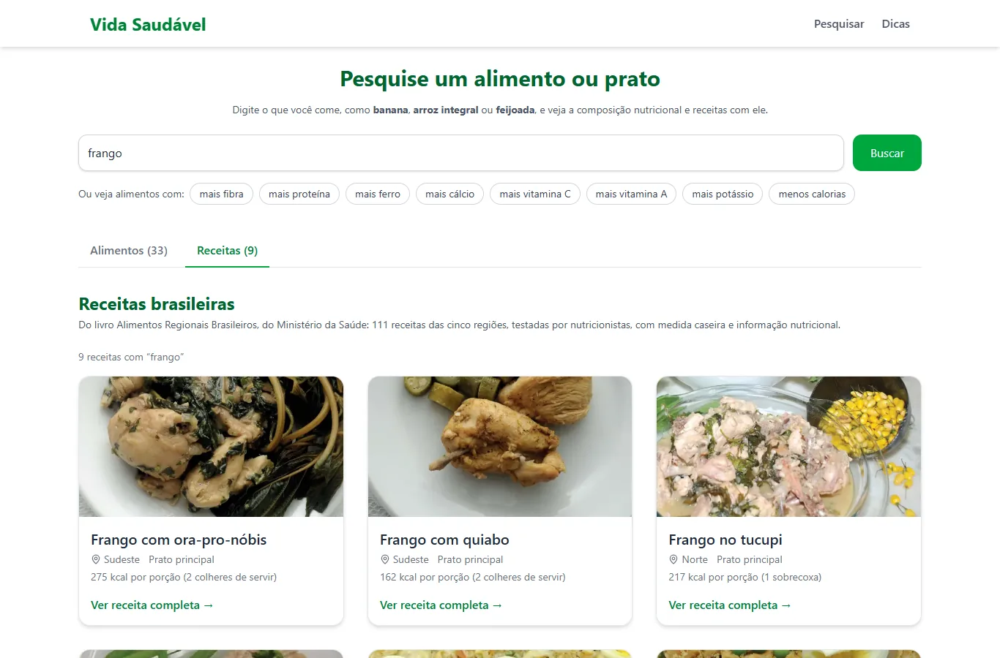
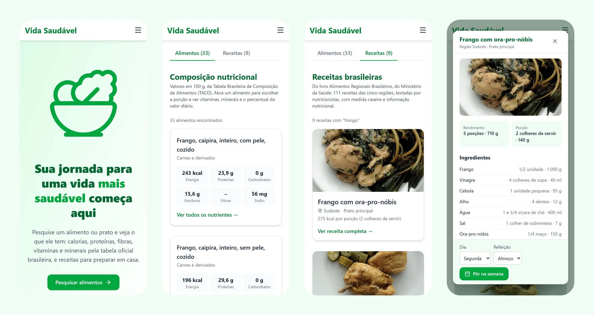

# Vida Saudável

Para saber o que tem no que se come e montar refeições equilibradas, com dados oficiais
brasileiros. React 19, TypeScript, Tailwind e Vite.

**No ar:** [vida-saudavel-tau.vercel.app](https://vida-saudavel-tau.vercel.app)



<details>
<summary>No celular</summary>



</details>

A página segue o layout original do projeto: topo, busca, dicas. Nada de tabela aberta logo de
cara: os dados aparecem quando a pessoa pesquisa um alimento ou prato.

- **Composição:** os alimentos com o nome pesquisado, entre os 597 da Tabela Brasileira de
  Composição de Alimentos (TACO, NEPA/UNICAMP).
- **Receitas brasileiras:** 111 receitas do livro *Alimentos Regionais Brasileiros*, do
  Ministério da Saúde, das cinco regiões, com foto, medida caseira e informação nutricional.
- **Semana e lista de compras:** as receitas vão para a semana, e a lista soma os ingredientes.
- **Sugestões:** um toque em "mais fibra", "mais ferro" etc. lista os alimentos com mais (ou
  menos) daquele nutriente.
- **Meu prato:** o total do prato montado, com o valor diário da Anvisa.
- **Dicas:** os dez passos do Guia Alimentar do Ministério da Saúde.

## O que faz

- **Pesquisa.** Um campo só, para alimento ou prato ("banana", "feijoada", "arroz com feijão").
  - Acha pelo nome sem precisar de acento, com as palavras em qualquer ordem: "feijao preto" acha
    "Feijão, preto, cozido". Palavras de ligação ("de", "com") são ignoradas.
  - Cada alimento aparece num cartão com energia, proteínas, carboidratos, gorduras, fibras e
    sódio em 100 g.
  - A comida do dia a dia vem primeiro: o cozido antes do cru, e a fruta antes do doce de fruta.
  - O resultado vem em duas abas, uma de cada vez: **Alimentos** e **Receitas**, com a contagem
    de cada uma. Se o termo é um prato sem alimento com esse nome ("moqueca"), abre direto em
    Receitas.
- **Ficha do alimento.** Porção de 50, 100, 150 ou 200 g, ou qualquer valor até 2 kg. Mostra
  energia, macronutrientes, fibra, sódio, colesterol, minerais e vitaminas, cada um com o %VD da
  Anvisa (IN nº 75/2020) e uma barra.
- **Sugestões por nutriente.**
  - **Objetivos:** mais fibra, proteína, ferro, cálcio, vitamina C, vitamina A ou potássio, ou
    menos calorias.
  - **Base:** por 100 g, ou por 100 kcal, que mostra quem entrega mais do nutriente com menos
    calorias. Dá para limitar a um grupo da TACO.
  - **Fora da lista:** sal, doces, bebidas, óleos, alimentos crus que só se comem cozidos,
    concentrados, frutas em calda e ultraprocessados.
- **Meu prato.** Aparece quando o primeiro alimento entra. Cada alimento entra com a sua porção, e
  as gramas podem ser trocadas depois. O total vem com %VD e pode ser copiado. O prato fica no
  navegador, conferido ao ler. Se algum alimento não tem um nutriente na tabela, o total avisa
  que é parcial em vez de contar zero.
- **Receitas brasileiras.** As 111 fichas técnicas de *Alimentos Regionais Brasileiros*
  (Ministério da Saúde, 2015), testadas no laboratório de técnica dietética da UnB. A origem, a
  licença e a extração estão em [`docs/receitas.md`](docs/receitas.md).
  - **Busca:** pelo nome e pelos ingredientes ("frango" acha o "Frango no tucupi" e a "Galinhada
    com pequi"). Sem receita com todas as palavras, mostra as parecidas: "bolo de milho" mostra
    os bolos.
  - **Ficha:** foto do livro, ingredientes com medida caseira e peso bruto, modo de preparo por
    etapas, rendimento, porção e informação nutricional por porção, com o %VD da Anvisa.
  - **Sem serviço externo:** as receitas vão junto com o site, sem chave nem limite de consultas.
- **Receitas internacionais.** Com a chave do Spoonacular no servidor (detalhes abaixo), um botão
  no fim da aba de receitas mostra também receitas de outros países, em inglês, das de melhor nota
  de saúde para as de pior. O Spoonacular só é consultado quando a pessoa pede.
- **Semana e lista de compras.** Qualquer receita, brasileira ou internacional, pode ir para um
  dia e refeição da semana. A lista de compras soma o mesmo ingrediente na mesma unidade. As
  brasileiras usam o peso bruto do livro, e as internacionais são buscadas de novo no Spoonacular.
  A semana aparece quando a primeira receita entra.
- **Dicas.** Os dez passos do
  [Guia Alimentar para a População Brasileira](https://bvsms.saude.gov.br/bvs/publicacoes/guia_alimentar_populacao_brasileira_2ed.pdf)
  (Ministério da Saúde, 2014), três de cada vez, com os títulos do guia e resumos meus.

## Dados

A extração da TACO, a conferência e os valores diários de referência estão documentados em
[`docs/dados.md`](docs/dados.md):

- o arquivo de origem, com o SHA-256;
- os scripts de extração e de conferência, em `scripts/taco/`;
- as checagens de coerência.

A tabela (200 KB, cerca de 30 KB comprimida) é baixada à parte, depois da página. Ela vai junto
com o site, sem depender de serviço externo nem de chave.

As receitas brasileiras têm o mesmo tratamento, em [`docs/receitas.md`](docs/receitas.md):

- o livro de origem, com o SHA-256 e a licença;
- os scripts de extração, em `scripts/receitas-ms/`;
- as leituras que pediram decisão, como o sódio impresso em "g";
- as conferências contra o livro.

Os dados e as fotos dessas receitas (`src/receitas/ministerio.json` e `public/receitas/`)
seguem a licença do livro, CC BY-NC-SA 4.0.

## Receitas: termos do Spoonacular

Os [termos de uso do Spoonacular](https://spoonacular.com/food-api/terms) definem três decisões
do projeto:

- **Sem cache.** Guardar respostas exige autorização prévia por escrito e vale por no máximo
  1 hora. A função responde com `Cache-Control: no-store`.
- **Só id, título e imagem guardados.** O plano da semana guarda só isso no navegador, e a lista
  de compras busca os ingredientes de novo cada vez que é montada.
- **Crédito à fonte.** Cada receita mostra o nome e o link do site de origem.

## A chave da API fica no servidor

O navegador nunca recebe a chave do Spoonacular. Ele chama `/api/receitas`, e a função em
[`api/receitas.js`](api/receitas.js) faz a consulta com a chave lida de `SPOONACULAR_API_KEY`,
enviada por cabeçalho e não pela URL. A função aceita três consultas:

| Consulta | Uso |
|---|---|
| `status` | diz se a chave está configurada, sem consultar o Spoonacular |
| `q`, com `dieta`, `sem` (`gluten`, `lactose`), `tempo`, `refeicao`, `pagina` | busca |
| `ids=1,2,3` (até 21) | receitas do plano, para a lista de compras |

Valores fora da lista recebem 400 sem chamar o Spoonacular. Quando a cota diária acaba, a página
diz isso em vez de um erro genérico.

O `vercel.json` define a política de segurança: scripts e dados só do próprio site, e imagens só
do próprio site e do Spoonacular.

## Rodando localmente

Requer Node 22.12 ou mais novo.

```bash
cp .env.example .env    # opcional: a chave do Spoonacular, para as receitas
npm install
npm run dev
```

```bash
npm run lint
npm test            # função de servidor (node:test), tabela, busca, sugestões, prato e lista (Vitest)
npm run test:e2e    # navegador, no celular e no desktop, com a mesma política de segurança da Vercel
npm run build
```

## Limitações

- **Por 100 g, não por porção caseira.** A TACO não traz medidas como "1 concha" ou "1 unidade
  média". A porção é escolhida em gramas.
- **A tabela é de 2011.** É a edição mais recente da TACO. Produtos industrializados mudam de
  receita com o tempo, e é por isso que as sugestões deixam os industrializados de fora.
- **Não é orientação nutricional.** O %VD usa a referência de rótulo da Anvisa (2.000 kcal), não
  a necessidade de cada pessoa.
- **São 111 receitas brasileiras.** É o que o livro do Ministério traz. Pratos fora dele, como
  "bolo de milho", aparecem como parecidos, não como receita exata. A base pode crescer com
  outras publicações de licença aberta, sempre com a licença conferida antes.
- **Receitas internacionais em inglês.** O modo de preparo vem como está na fonte.
- **O prato e o plano ficam só no navegador** onde foram feitos.
- **Uso comercial das receitas.** As receitas brasileiras são CC BY-NC-SA 4.0, sem uso
  comercial. O Spoonacular em produção depende de um plano pago compatível com o volume de
  acessos. A parte de alimentos não tem essas restrições.
